# Arsitektur Sistem — Serayu (Tata Ruang Banjarnegara)

Dokumen ini menjelaskan arsitektur sistem pengolahan dan visualisasi data geospasial Rencana Tata Ruang Wilayah (RTRW) Kabupaten Banjarnegara 2023–2043 (Peraturan Daerah Kabupaten Banjarnegara Nomor 6 Tahun 2023) beserta modul turunan perencanaan 2D dan 3D.

---

## 1. Ikhtisar Arsitektur

Proyek **Serayu** dirancang dengan filosofi **Serverless Static GIS Architecture**:
- **0 Server GIS Berat:** Tidak memerlukan GeoServer, MapServer, ArcGIS Server, atau database spasial relasional (PostGIS) di sisi produksi.
- **0 Biaya & Kunci API:** Peta dasar satelit dan jalan mengandalkan penyedia publik terbuka (Esri World Imagery, Google Satellite Tiles, EOX Sentinel-2, Esri Street Map) dengan mekanisme failover otomatis.
- **0 Build Step:** Seluruh antarmuka web dibangun menggunakan Vanilla JavaScript (ES6+), Leaflet 1.9.4, Three.js r128, dan CSS modern tanpa bundling toolchain (Webpack/Vite/Rollup) maupun transpiler.
- **Multi-Modal Geospatial Suite:**
  1. **2D Hierarchical Web GIS (`web/index.html`):** Viewer 3 tingkat hierarki (Kabupaten → Kecamatan → Desa).
  2. **Split-Screen Comparator (`web/banding.html`):** Analisis komparasi swipe horizontal antara pola ruang dan sebaran bangunan.
  3. **Singapore URA SPACE Urban Portal (`web/space.html`):** Portal detail perkotaan Kecamatan Banjarnegara dengan 10.918 bangunan kadaster, 277 zona pola ruang, aturan ITBX, dan isolasi kelurahan murni.
  4. **3D Elevation & Landscape Visualizer (`web/3d.html`):** Terrain mesh 3D Three.js berbasis SRTM DEM 30m nyata dengan sistem instanced trees dan ekspor model 3D (OBJ, GLTF, STL, 3MF).

```mermaid
flowchart TD
    subgraph S1["1. Raw Ingestion & Source Data"]
        A1["rencana_pola_ruang.json (63.2 MB, EPSG:4326)"]
        A2["batas_administrasi.json (3.8 MB, EPSG:32749)"]
        A3["sungai_banjarnegara.json (3.3 MB, EPSG:32749)"]
        A4["jaringan_transportasi.json (1.8 MB, EPSG:4326)"]
        A5["SRTM DEM 30m / OpenTopography (GeoTIFF)"]
        A6["OSM Building Footprints & SK Bupati 620/228"]
    end

    subgraph S2["2. Processing Pipeline (Python Engine)"]
        B1["convert.py: Reproyeksi EPSG:4326, Drop Sliver (<100m²), 6 Desimal"]
        B2["ringkasan.py: Agregasi Luas Legenda Geodesik"]
        B3["kabupaten_layer.py: Dissolve + Simplify (~25m)"]
        B4["desa_layer.py: Spatial Clip STRtree (278 Desa)"]
        B5["generator_model_3d.py: DEM Resampling, Mesh Matrix, Tree Instancer"]
        B6["clip_desa_layers.py: Intersection Kadaster & Pola Ruang 13 Kelurahan"]
    end

    subgraph S3["3. Optimized Static Data Store (Flat-Files)"]
        C1["geojson/index/ (Dissolved Kabupaten ~3.95 MB)"]
        C2["geojson/per-kecamatan/ (20 Kecamatan, 80 File)"]
        C3["geojson/per-desa/ (278 Desa, 1.108 File)"]
        C4["web/data/desa_clipped_layers.json (6.18 MB pre-clipped)"]
        C5["web/data/kecamatan_banjarnegara_buildings.geojson (10.918 unit)"]
        C6["web/data/kecamatan_banjarnegara_poi.json (12 titik landmark)"]
    end

    subgraph S4["4. Client Frontend Applications"]
        D1["web/index.html (Hierarchical Viewer Leaflet)"]
        D2["web/banding.html (Dual-Map Swipe Comparator)"]
        D3["web/space.html (URA Space Planning Portal + ITBX)"]
        D4["web/3d.html (Three.js WebGL Elevation Terrain)"]
        D5["web/kadaster.html (Inspektur Persil Kadaster Satelit 2026)"]
    end

    S1 --> S2 --> S3 --> S4
```

---

## 2. Arsitektur Komponen Baru

### 2.1 SIMTARU SPACE (Singapore URA Model)
- **Spatial Dataset Replacement Engine:** Menggantikan pendekatan visual masking dengan penggantian data layer langsung (`clearLayers()` + `addData()`) dari `desa_clipped_layers.json`. Menjamin 0 fitur layer yang muncul di luar batas desa/kelurahan terpilih.
- **Leaflet Canvas Renderer:** Seluruh 10.918 bangunan kadaster dan 277 zona pola ruang dirender menggunakan canvas hardware-accelerated (`L.canvas({ padding: 0.5 })`), menjaga performa 60 FPS pada browser tanpa kebocoran memori DOM.
- **ITBX Regulatory Rules Engine:** Database aturan zonasi internal mengidentifikasi KODKWS untuk memvalidasi ketentuan **I** (Diizinkan), **T** (Terbatas), **B** (Bersyarat), **X** (Dilarang), serta intensitas bangunan (KDB, KLB, KDH, GSB).

### 2.2 Three.js 3D Elevation Terrain Visualizer
- **Proyeksi UTM Zone 49S:** Elevasi topografi diolah pada satuan meter riil (1:1 scale) sehingga gradien kemiringan lereng perbukitan selatan Banjarnegara, lembah Serayu, hingga dataran tinggi Dieng akurat secara geodesik.
- **Tree Clumping & Building Instancing:** Pepohonan diatur menggunakan `THREE.InstancedMesh` dengan clustering probabilistik berbasis elevasi dan tutupan lahan untuk efisiensi render GPU.
- **Export Pipeline:** Modul ekspor menghasilkan file 3D siap cetak/impor (OBJ dengan MTL, GLTF/GLB biner, STL untuk 3D print, dan 3MF).

### 2.3 Cadastral Satellite 2026 Extractor Engine
- **Tile Fetcher & Stitcher (`tools/kadaster_extractor/`):** Mengunduh paralel asinkron (`aiohttp`) ubin Google Maps Satelit 2026 zoom 18/19 dan merakitnya menjadi raster komputasi spasial WGS84.
- **Watershed Instance Separation (`detector.py`):** Menggunakan *Euclidean Distance Transform* dan deteksi puncak bubungan atap untuk memisahkan persil bangunan yang saling berhimpitan di kawasan perkotaan/desa.
- **Orthogonal Rectification Engine (`regularizer.py`):** Menjamin geometri persil bangunan memiliki sudut siku-siku $90^\circ$ (96,2% kotak/OBB) dan majemuk ortogonal (3,8% leter-L/T), bebas dari gerigi gergaji acak.
- **Inspektur Persil Interaktif (`web/kadaster.html`):** Memungkinkan komparasi langsung poligon vektor persil di atas citra satelit sumber dengan pengatur transparansi $0-100\%$, mode wireframe, dan filter per kelurahan.
