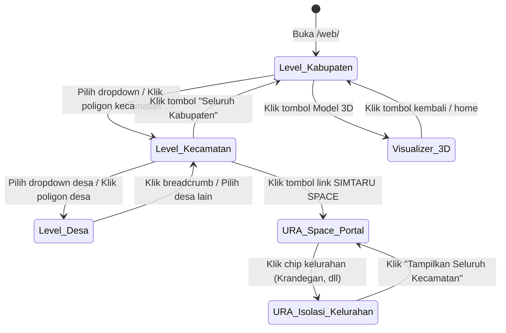

# Peta Rute & Navigasi Statis — Serayu

Aplikasi Serayu berjalan sebagai **Client-Side Spatial Application (CSSA)** tanpa routing framework berbasis router JavaScript eksternal. Seluruh transisi status dikontrol via manipulasi DOM, Leaflet state, Three.js camera rendering, dan sinkronisasi status UI.

---

## 1. Frontend Routes (Pages)

| Route Path | File Target | Page Title | Auth | Deskripsi & Mode |
|---|---|---|---|---|
| `/web/` atau `/web/index.html` | `web/index.html` | Peta Tata Ruang Kabupaten Banjarnegara | Publik | Viewer interaktif utama 3 tingkat hierarki (Kabupaten, Kecamatan, Desa) dengan mode Pola Ruang (13 kelas) & Rawan Bencana (3 kategori). |
| `/web/banding.html` | `web/banding.html` | Perbandingan Tata Ruang — Banjarnegara | Publik | Antarmuka komparasi split-screen (swipe slider) antara zonasi RTRW dan sebaran kepadatan bangunan OpenStreetMap / citra satelit. |
| `/web/space.html` | `web/space.html` | SIMTARU SPACE — Kecamatan Banjarnegara | Publik | Portal tata ruang terinspirasi Singapore URA SPACE (277 Rencana Pola Ruang, 10.918 Persil Bangunan Kadaster, ITBX Development Control, Isolasi 13 Kelurahan/Desa, dan 12 Landmark Terkalibrasi). |
| `/web/3d.html` | `web/3d.html` | 3D Terrain & Landscape — Banjarnegara | Publik | Visualisasi elevasi 3D interaktif Three.js berbasis elevasi DEM SRTM nyata (UTM 49S), gerombol vegetasi/pohon adaptif, sebaran bangunan, tekstur satelit/pola ruang, dan ekspor model 3D (OBJ/GLTF/STL/3MF). |

---

## 2. Parameter URL & State Transisi

### 2.1 Viewer Utama (`web/index.html`)
| Parameter | Tipe | Contoh Nilai | Efek pada Tampilan |
|---|---|---|---|
| `kec` | Query String / State | `?kec=banjarmangu` | Memfilter peta ke wilayah kecamatan terpilih, memuat 4 layer kecamatan, dan memperbarui angka legenda. |
| `desa` | Query String / State | `?kec=banjarmangu&desa=banjarkulon` | Melakukan zoom-in ke poligon desa, memuat layer terklip per-desa, dan memperbarui ringkasan desa. |
| `mode` | State UI | `"pola"` atau `"krb"` | Mengalihkan pewarnaan layer poligon antara Pola Ruang (Permen ATR/BPN 1/2020) atau Kawasan Rawan Bencana (KRB_03). |

### 2.2 URA SPACE Portal (`web/space.html`)
| State Identifier | Tipe | Contoh Nilai | Efek pada Tampilan |
|---|---|---|---|
| `activeDesaFilter` | In-Memory State | `"Kel.Krandegan"` | Mengisolasi total peta: menghapus seluruh layer di luar kelurahan terpilih (0 layer di luar), memuat layer terpotong spasial murni, mengunci zoom batas desa, dan membuka Inspector ITBX. |
| `activeDesaFilter = null` | In-Memory State | `null` | Memulihkan dataset penuh 1 kecamatan (13 kelurahan, 10.918 bangunan, 277 zona) dan menyembunyikan Inspector. |
| `measureMode` | State UI | `"distance"` / `"area"` | Mengaktifkan pointer pengukuran polyline (meter/km) atau poligon luas lahan (m²/hektar). |

---

## 3. Matriks Transisi Status Tampilan (View Hierarchy)

### Karakteristik per Tingkat:
1. **Level Kabupaten (`web/index.html`):**
   - Memuat: `index/batas_kecamatan.geojson`, `index/kab_pola_ruang.geojson`, `index/kab_transportasi.geojson`, `index/kab_sungai.geojson`.
   - Total data ditransfer: $\sim 3,95\text{ MB}$.
2. **Level Kecamatan (`web/index.html`):**
   - Memuat: 4 berkas dari `per-kecamatan/{kecamatan}/` (pola ruang, batas desa, transportasi, sungai).
   - Total data ditransfer: $0,2\text{ MB} - 3,6\text{ MB}$.
3. **Level Desa (`web/index.html`):**
   - Memuat: Berkas dari `per-desa/{kecamatan}/{desa}/`.
   - Total data ditransfer: $\sim 45\text{ KB}$.
4. **Tingkat Urban Planning & Kadaster (`web/space.html`):**
   - Fokus: Khusus Kecamatan Banjarnegara (Ibu Kota Kabupaten).
   - Memuat: `data/desa_clipped_layers.json` ($6,18\text{ MB}$), `data/kecamatan_banjarnegara_buildings.geojson` ($4,3\text{ MB}$), `data/kecamatan_banjarnegara_poi.json`.
   - Fitur: Zero layer outside village, ITBX development controls, Canvas rendering.
5. **Tingkat Elevasi & Lansekap 3D (`web/3d.html`):**
   - Fokus: Topografi makro dan mikrolansekap Three.js (mesh terrain $128 \times 128$ atau $256 \times 256$).
   - Fitur: OrbitControls, ketinggian hiper-realistis, shader tekstur, dan ekspor multi-format 3D.
